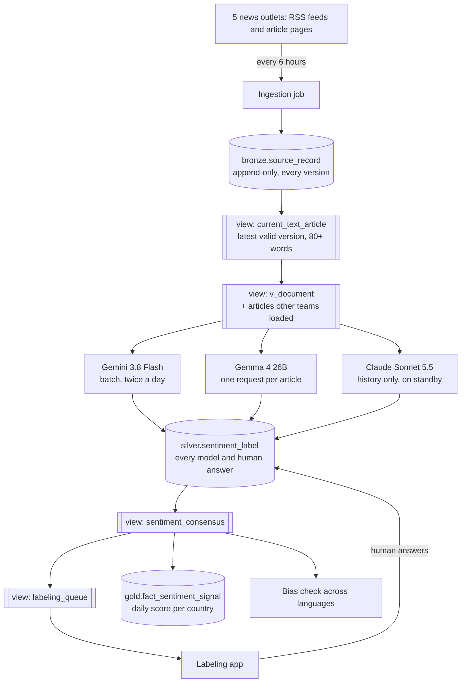

# LLM ensemble sentiment ETL

An ETL pipeline on Google Cloud that collects news articles, has three LLMs label the sentiment toward each country they cover, settles disagreements with a best-2-of-3 vote, and sends the rest to human labelers.

Built between April and November 2026 as part of an industry practicum. All numbers are as of 26 October 2026.

## The problem

The product tracks how the news portrays African countries, as a daily score per country, for people deciding whether to invest or do business there. Sentiment must be **per article and per country**: one article can be good news for Morocco and bad news for Algeria. And it must work in Arabic, French and Swahili without translating first.

## How the pieces fit



Cylinders are tables; double-sided boxes are **views** (saved queries that store no data). Bronze, silver and gold are data layers, from raw to finished.

Everything runs on Google Cloud: **BigQuery** stores the data, **Vertex AI** runs Gemini and Gemma, and **Cloud Run jobs**, started by **Cloud Scheduler**, do the work as one service account.

We reused these tables from an existing data dictionary: `bronze.source_record`, `silver.document`, `gold.dim_country`, `gold.dim_source` and `audit.etl_run`. The rest is our design. One table, `silver.sentiment_label`, holds every model and human answer. The consensus, the human queue and the document list are views, so nothing is stored twice.

## Collecting the news

Every 6 hours a Cloud Run job collects full articles from BBC Swahili, BBC Arabic, Hespress (Morocco, Arabic), AllAfrica French and Africanews French. Per-outlet settings live in `config/sentiment_sources.yaml`, so adding an outlet is a config change.

**Rules.**

- Full article or drop the source: at least 80 words, never an RSS summary.
- No audio, radio or video pages.
- No country at this stage; the models assign countries later.
- Append-only: edits add versions, and a view serves the latest valid one. `document_id` hashes the outlet plus canonical URL, so it survives edits; `source_version` hashes the title plus text; a normalized hash skips formatting-only edits.
- Fix things generically, not per outlet.
- Preview before deleting (a read-only count and sample).

**Challenges and fixes.**

| What we found | What we did |
|---|---|
| Financial Afrik (a sixth outlet) served only teasers: median 56 words, 225 of 388 under 100. | Dropped the source and deleted its rows. |
| Hespress video and cartoon posts stored a 14–18-word fallback line as text. | Excluded those categories; stripped the footer everywhere. |
| 66 BBC Swahili radio pages looked like short articles. | Excluded their URL pattern. |
| BBC's "most read" box was in 323 of 357 BBC Arabic articles. | Removed those page sections before collecting text. Boilerplate is matched by page structure or exact markers (matching "maarufu", a common Swahili word, gave false hits). |
| Country guessed from the publisher: every Hespress story was Morocco. | Removed it from ingestion. |
| A BBC Swahili live page grew from 3,948 to 8,318 words over 34 versions. | Versioning, plus the latest-version view. |
| Hespress posts about 95 a day, but its feed lists 12; one read per 6 hours kept about 41. | Page through the feed to a known post (at most 10 pages). A backfill of 461 pages, back to about 21 August, added 2,431 articles. Now 80–87 a day. |

**Clean-up (22 September).** An audit found 4,462 articles from six outlets; all integrity checks passed. After a read-only preview we deleted 657 invalid rows: 388 Financial Afrik, 159 Hespress video and cartoon, 66 BBC Swahili radio, 43 under 80 words and one summary-only. The view then held 3,823 articles.

**Health.** 102 of 103 scheduled runs succeeded from 22 September to 17 October. After the backfill there were 9,411 articles, about half from Hespress. **Still open:** a rights decision on AllAfrica, which republishes member papers, before scraping it at scale.

## The three AI labelers

The "agents" are AI labelers: one model, one article, one structured answer, run as scheduled batch jobs.

**The task.** Each model gets the same prompt (`etl/sentiment_scoring/prompts/tag_and_sentiment_v1.md`) and the article in its original language, without the outlet's name. It returns JSON with:

- the African countries the article is **substantially about**, at most 5 (not mere background, comparisons, list items or a quoted person's home);
- a label per country, for an investor (POSITIVE, NEGATIVE, NEUTRAL, MIXED or UNCERTAIN), and a score from -1 to 1;
- one or two quotes copied exactly from the article.

**No confidence scores**: agreement between models is the signal.

| | Gemini | Gemma | Claude |
|---|---|---|---|
| Model | `gemini-3.8-flash` | `gemma-4-26b-a4b-it-maas` | `claude-sonnet-5-5` |
| Runs on | Vertex AI batch, twice a day | Vertex AI pay-per-token, one request per article, 2 in parallel | Anthropic Message Batches, once, for the history; paid personally by the author ($34.73) |
| Thinking first | Low | None | Low |
| Articles scored | 10,944 (first pass), then new ones | 11,087 (full re-score) | 11,016 |
| In the vote | Yes | Yes | No: standby until enabled on Vertex AI (Model Garden) |

**Why these three.** Gemini Flash is cheap and runs as a batch. Earlier Gemma models ranked best among open models on African-language benchmarks (AfroBench, IrokoBench). Claude comes from a different company. A `billing_tag` marks runs paid outside the project's own billing.

**Versioning.** Each answer's `model_version` combines the model, prompt name and prompt hash. Any change makes a new version; old answers stay.

**Final answer.** The `sentiment_consensus` view picks one per article and country: unanimous, provisional (model majority, flagged, until a person answers), human, two humans agreed, or contested (falls back to the flagged model majority).

**Daily score.** Each article counts +1 (positive), -1 (negative) or 0 (neutral or mixed); UNCERTAIN is left out. One vote per outlet per country per day. Scores run from 0 to 100 (50 neutral), with an uncertainty range. Days with fewer than 3 articles or 2 outlets are flagged as low coverage but shown.

**Bias check.** For a country covered in at least two languages, each language's label mix is compared with its overall mix (KL divergence; flag above 0.15). A gap can come from the outlets, not just the models. Flags never hide data.

**First results** (Gemini's first pass, 24 October). 77% of articles were about at least one African country (1.24 per such article); 23% were about none. Labels: 32% positive, 33% negative, 28% neutral, 6% mixed. Morocco led with 4,050 articles, largely because of Hespress. The daily series covered 55 countries.

## Repository map and how to run

| Path | What it is |
|---|---|
| `etl/sentiment_ingestion/`, `run_sentiment_ingestion.py`, `config/sentiment_sources.yaml` | News collection (one fetcher per outlet) |
| `analysis/` | Audit and clean-up SQL, the `current_text_article` view, the 22 September audit report |
| `etl/sentiment_scoring/`, `run_sentiment_scoring.py`, `config/sentiment_models.yaml` | AI labelers, consensus views, daily series, bias check, agreement evaluation, Claude history loader |
| `etl/sentiment_scoring/sql/` | Our tables and views (`01_tables.sql`, `03_views.sql`, `04_aggregate_signal.sql`, `05_bias_kl.sql`, `06_billing_tag.sql`) |
| `labeling_app/` | Labeling web app |
| `experiments/` | Gemma investigation scripts |
| `tests/` | Offline tests (54) |
| `Dockerfile.*`, `cloudbuild.*.yaml`, `requirements.*.txt` | Container builds for the two jobs |

Run the tests and an offline collection (no cloud account needed):

```bash
python3 -m pytest tests -q
python3 run_sentiment_ingestion.py --sources all --days 2 --max 5 --dry-run /tmp/bronze_dryrun
```

Everything else needs a Google Cloud project with BigQuery and Vertex AI, and `BQ_PROJECT` set (no default, on purpose). The SQL files use the placeholder project `your-gcp-project`; replace it with yours. `01_tables.sql` creates only our tables, not the reused dictionary ones.

```bash
python3 run_sentiment_scoring.py serial --limit 20   # also: register, submit, collect, aggregate, bias, agreement
python3 run_sentiment_scoring.py claude-history      # needs `pip install anthropic` and an Anthropic API key
cd labeling_app && BQ_PROJECT=<project> uvicorn main:app --port 8080
```
