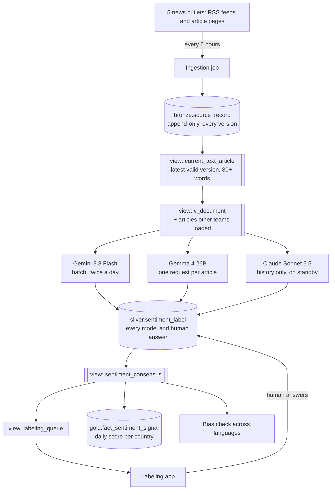

# LLM ensemble sentiment ETL

An ETL pipeline on Google Cloud that collects news articles, has three LLMs label the sentiment toward each country they cover, settles disagreements with a best-2-of-3 vote, and sends the rest to human labelers.

Built between April and November 2026 as part of an industry practicum. All numbers are as of 26 October 2026.

## The problem

The product tracks how the news portrays African countries, as a daily score per country, for people deciding whether to invest or do business there. Sentiment must be **per article and per country**: one article can be good news for Morocco and bad news for Algeria. And it must work in Arabic, French and Swahili without translating first.

## How the pieces fit



Cylinders are tables; double-sided boxes are **views** (saved queries that store no data). Bronze, silver and gold are data layers, from raw to finished.

Everything runs on Google Cloud: **BigQuery** stores the data, **Vertex AI** runs Gemini and Gemma, and **Cloud Run jobs**, started by **Cloud Scheduler**, do the work as one service account.

We reused these tables from an existing data dictionary: `bronze.source_record`, `silver.document`, `gold.dim_country`, `gold.dim_source` and `audit.etl_run`. The rest is our design. One table, `silver.sentiment_label`, holds every model and human answer. The consensus, the human queue and the document list are views, so nothing is stored twice.

## Repository map and how to run

| Path | What it is |
|---|---|
| `etl/sentiment_ingestion/`, `run_sentiment_ingestion.py`, `config/sentiment_sources.yaml` | News collection (one fetcher per outlet) |
| `analysis/` | Audit and clean-up SQL, the `current_text_article` view, the 22 September audit report |
| `etl/sentiment_scoring/`, `run_sentiment_scoring.py`, `config/sentiment_models.yaml` | AI labelers, consensus views, daily series, bias check, agreement evaluation, Claude history loader |
| `etl/sentiment_scoring/sql/` | Our tables and views (`01_tables.sql`, `03_views.sql`, `04_aggregate_signal.sql`, `05_bias_kl.sql`, `06_billing_tag.sql`) |
| `labeling_app/` | Labeling web app |
| `experiments/` | Gemma investigation scripts |
| `tests/` | Offline tests (54) |
| `Dockerfile.*`, `cloudbuild.*.yaml`, `requirements.*.txt` | Container builds for the two jobs |

Run the tests and an offline collection (no cloud account needed):

```bash
python3 -m pytest tests -q
python3 run_sentiment_ingestion.py --sources all --days 2 --max 5 --dry-run /tmp/bronze_dryrun
```

Everything else needs a Google Cloud project with BigQuery and Vertex AI, and `BQ_PROJECT` set (no default, on purpose). The SQL files use the placeholder project `your-gcp-project`; replace it with yours. `01_tables.sql` creates only our tables, not the reused dictionary ones.

```bash
python3 run_sentiment_scoring.py serial --limit 20   # also: register, submit, collect, aggregate, bias, agreement
python3 run_sentiment_scoring.py claude-history      # needs `pip install anthropic` and an Anthropic API key
cd labeling_app && BQ_PROJECT=<project> uvicorn main:app --port 8080
```
