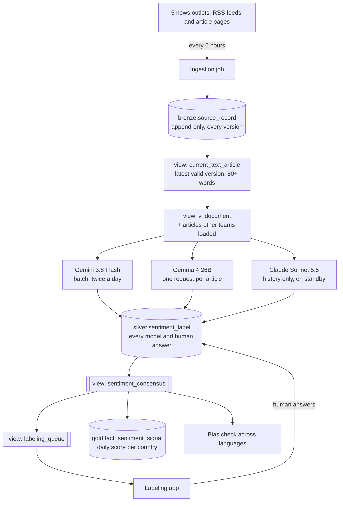
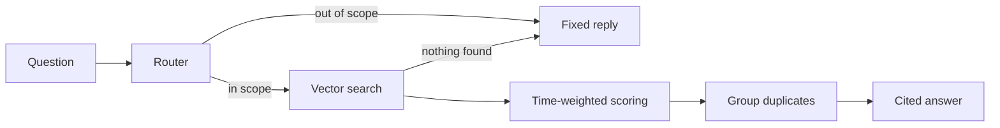

# LLM ensemble sentiment ETL

An ETL pipeline on Google Cloud that collects news articles, has three LLMs label the sentiment toward each country they cover, settles disagreements with a best-2-of-3 vote, and sends the rest to human labelers.

Built between April and November 2026 as part of an industry practicum. All numbers are as of 26 October 2026.

## The problem

The product tracks how the news portrays African countries, as a daily score per country, for people deciding whether to invest or do business there. Sentiment must be **per article and per country**: one article can be good news for Morocco and bad news for Algeria. And it must work in Arabic, French and Swahili without translating first.

## How the pieces fit



Cylinders are tables; double-sided boxes are **views** (saved queries that store no data). Bronze, silver and gold are data layers, from raw to finished.

Everything runs on Google Cloud: **BigQuery** stores the data, **Vertex AI** runs Gemini and Gemma, and **Cloud Run jobs**, started by **Cloud Scheduler**, do the work as one service account.

We reused these tables from an existing data dictionary: `bronze.source_record`, `silver.document`, `gold.dim_country`, `gold.dim_source` and `audit.etl_run`. The rest is our design. One table, `silver.sentiment_label`, holds every model and human answer. The consensus, the human queue and the document list are views, so nothing is stored twice.

## Design decisions

The choices that shaped the pipeline: what we did instead, and why. Most apply to any pipeline that runs language models over collected text.

| Decision | Instead of | Why |
|---|---|---|
| **The model tags countries, not the collector** | A rule-based script in the collection job (tried first): it matched country names and fell back to the publisher's country, so every Hespress story became Morocco. | It gave false positives and couldn't handle stories about several countries. The model already reads each article for sentiment, so it tags countries in the same call at no extra cost. |
| **Score each (article, country) pair, only for countries the article is substantially about** | One country per article; later, four role labels (main subject, affected, actor, mentioned). | One article can be good news for one country and bad for another. One test with an exclusion list (lists, comparisons, background, a quoted person's home) is simpler for models and people than four roles. |
| **Full article or drop the source** | Accepting RSS summaries and teasers. | Thin text corrupts sentiment. Financial Afrik was dropped, not patched. |
| **Never overwrite raw data; a view serves the latest version** | Updating an article in place when the publisher edits it. | Every model answer traces to the exact text it read, and publisher corrections stay visible. |
| **One generic way to recognize versions** | Per-outlet duplicate rules. | Stable IDs and content hashes work for every source; a normalized hash ignores formatting-only edits. Unchanged items are skipped before download (feed date, then ETag/Last-Modified, then hash). |
| **Page through feeds until a known item, with a cap; backfill separately** | One feed page per run. | Hespress's 12-item feed lost more than half its posts between runs. The cap (10 pages, about 30 hours of posts) bounds each run; hitting it is logged as a possible gap. |
| **Preview, prevent, then delete** | Deleting bad rows first. | Read-only previews caught real bugs, and deploying the filter first means deleted rows can't come back. |
| **Everything after collection ignores the source** | Per-source handling in scoring. | Other teams keep adding sources. Any article in the shared document view is scored the same way, so a new source needs no scoring change. |
| **One table for every answer; views for the rest** | Separate tables per model and for human labels, and a stored consensus. | Nothing is stored twice, and changing a rule (like best 2 of 3) is a view change, not a data migration. |
| **Keep a model registry and a batch-job log** | A smaller schema without them (we dropped both, then brought them back). | You need to know which model versions are active and which batch jobs are still running. |
| **Versions from a prompt hash** | Manual version numbers. | Any change to the model, prompt or answer format creates a new version automatically; old answers stay comparable. |
| **Batch scoring twice a day** | Scoring each article as it arrives. | Batch costs about half as much, and a daily series doesn't need minute-fresh data. Gemma has no batch option, so it runs one request at a time. |
| **No model confidence scores** | Asking each model how sure it is. | Closed models change and retire, so their self-reported confidence isn't stable. Agreement between models is the signal. |
| **One vote per outlet per country per day** | Counting every article. | Hespress is half the collection and would drown out the other outlets. |
| **Flag, never hide** | Hiding low-coverage days and failed bias checks. | Readers see the data with its warnings and decide for themselves. |
| **Immutable image tags; jobs run as a service account** | A `:latest` tag and key files. | Every run traces to an exact image, and there are no keys to leak. |

## Collecting the news

Every 6 hours a Cloud Run job collects full articles from BBC Swahili, BBC Arabic, Hespress (Morocco, Arabic), AllAfrica French and Africanews French. Per-outlet settings live in `config/sentiment_sources.yaml`, so adding an outlet is a config change.

**Rules.**

- Full article or drop the source: at least 80 words, never an RSS summary.
- No audio, radio or video pages.
- No country at this stage; the models assign countries later.
- Append-only: edits add versions, and a view serves the latest valid one. `document_id` hashes the outlet plus canonical URL, so it survives edits; `source_version` hashes the title plus text; a normalized hash skips formatting-only edits.
- Fix things generically, not per outlet.
- Preview before deleting (a read-only count and sample).

**Challenges and fixes.**

| What we found | What we did |
|---|---|
| Financial Afrik (a sixth outlet) served only teasers: median 56 words, 225 of 388 under 100. | Dropped the source and deleted its rows. |
| Hespress video and cartoon posts stored a 14–18-word fallback line as text. | Excluded those categories; stripped the footer everywhere. |
| 66 BBC Swahili radio pages looked like short articles. | Excluded their URL pattern. |
| BBC's "most read" box was in 323 of 357 BBC Arabic articles. | Removed those page sections before collecting text. Boilerplate is matched by page structure or exact markers (matching "maarufu", a common Swahili word, gave false hits). |
| Country guessed from the publisher: every Hespress story was Morocco. | Removed it from ingestion. |
| A BBC Swahili live page grew from 3,948 to 8,318 words over 34 versions. | Versioning, plus the latest-version view. |
| Hespress posts about 95 a day, but its feed lists 12; one read per 6 hours kept about 41. | Page through the feed to a known post (at most 10 pages). A backfill of 461 pages, back to about 21 August, added 2,431 articles. Now 80–87 a day. |

**Clean-up (22 September).** An audit found 4,462 articles from six outlets; all integrity checks passed. After a read-only preview we deleted 657 invalid rows: 388 Financial Afrik, 159 Hespress video and cartoon, 66 BBC Swahili radio, 43 under 80 words and one summary-only. The view then held 3,823 articles.

**Health.** 102 of 103 scheduled runs succeeded from 22 September to 17 October. After the backfill there were 9,411 articles, about half from Hespress. **Still open:** a rights decision on AllAfrica, which republishes member papers, before scraping it at scale.

## The three AI labelers

The "agents" are AI labelers: one model, one article, one structured answer, run as scheduled batch jobs.

**The task.** Each model gets the same prompt (`etl/sentiment_scoring/prompts/tag_and_sentiment_v1.md`) and the article in its original language, without the outlet's name. It returns JSON with:

- the African countries the article is **substantially about**, at most 5 (not mere background, comparisons, list items or a quoted person's home);
- a label per country, for an investor (POSITIVE, NEGATIVE, NEUTRAL, MIXED or UNCERTAIN), and a score from -1 to 1;
- one or two quotes copied exactly from the article.

**No confidence scores**: agreement between models is the signal.

| | Gemini | Gemma | Claude |
|---|---|---|---|
| Model | `gemini-3.8-flash` | `gemma-4-26b-a4b-it-maas` | `claude-sonnet-5-5` |
| Runs on | Vertex AI batch, twice a day | Vertex AI pay-per-token, one request per article, 2 in parallel | Anthropic Message Batches, once, for the history; paid personally by the author ($34.73) |
| Thinking first | Low | None | Low |
| Articles scored | 10,944 (first pass), then new ones | 11,087 (full re-score) | 11,016 |
| In the vote | Yes | Yes | No: standby until enabled on Vertex AI (Model Garden) |

**Why these three.** Gemini Flash is cheap and runs as a batch. Earlier Gemma models ranked best among open models on African-language benchmarks (AfroBench, IrokoBench). Claude comes from a different company. A `billing_tag` marks runs paid outside the project's own billing.

**Versioning.** Each answer's `model_version` combines the model, prompt name and prompt hash. Any change makes a new version; old answers stay.

**Final answer.** The `sentiment_consensus` view picks one per article and country: unanimous, provisional (model majority, flagged, until a person answers), human, two humans agreed, or contested (falls back to the flagged model majority).

**Daily score.** Each article counts +1 (positive), -1 (negative) or 0 (neutral or mixed); UNCERTAIN is left out. One vote per outlet per country per day. Scores run from 0 to 100 (50 neutral), with an uncertainty range. Days with fewer than 3 articles or 2 outlets are flagged as low coverage but shown.

**Bias check.** For a country covered in at least two languages, each language's label mix is compared with its overall mix (KL divergence; flag above 0.15). A gap can come from the outlets, not just the models. Flags never hide data.

**First results** (Gemini's first pass, 24 October). 77% of articles were about at least one African country (1.24 per such article); 23% were about none. Labels: 32% positive, 33% negative, 28% neutral, 6% mixed. Morocco led with 4,050 articles, largely because of Hespress. The daily series covered 55 countries.

## The labeling app

- Each item is one **(article, country)** pair, shown with the full text.
- Two questions: *Is this article substantially about this country?* If yes, *how does it portray it?* (5 options).
- Labelers **never see the models' answers** or why an item is queued.
- They log in with a personal code, see only their languages, and can skip, reopen and change answers.
- The `labeling_queue` view holds model disagreements, a 5% random audit of unanimous items, and second opinions on 20% of human-labeled items; at most two people per item.
- Answers are appended to `silver.sentiment_label` as `labeler_type = 'HUMAN'`, never edited.

FastAPI plus one HTML page (`labeling_app/`), deployed on 24 October as a private Cloud Run service.

**Status, honestly: deployed, never used.** The health check passed and the login rejected an unknown code, but no labeler accounts were created and there are no tests. Two likely issues were never exercised: **Skip probably re-shows the same item**, and the two-person limit is checked and written separately, so two people answering at once could exceed it.

## The experiment: should we keep Gemma?

**The problem.** Our starting rule was "any disagreement goes to a person". In the first two-model run (Gemini and Gemma, 1,532 pairs), 59% agreed fully, 16% were label splits (same country, different labels), and 23% were countries only Gemma named. With three models, 49% of 13,925 pairs (about 6,900) would go to people.

**The method.** `etl/sentiment_scoring/agreement.py` compares the models on articles all three answered, per language, and writes to `gold.model_evaluation_slice`. Its first run covered 10,918 articles: 5,965 Arabic, 4,193 French, 400 Swahili and 281 English. It measures solo countries (named by no other model), quotes found, the odd one out, pairwise label agreement, and the load on people under three rules.

**First results.** Gemma looked like the weak model.

| | Gemini | Claude | Gemma |
|---|---|---|---|
| Solo countries (share of all pairs) | 1.5% | 1% | **19%** |
| Quotes found in the article | 97% | 95% | **89%** |
| Odd one out when the other two agree | 23% | 33% | **44%** |

Label agreement by pair: Claude–Gemini 83%, Gemini–Gemma 80%, Claude–Gemma 77%. Gemma's solo countries were most common in Swahili (29%) and Arabic (23%), the very languages it was chosen for, and its quotes matched least there (84%, 88%). Label agreement was lowest in Arabic. Without Gemma, only 26% would go to people, so dropping it looked easy.

**Disagreements** (paraphrased):

- Debatable label splits: armed groups in the Central African Republic (Gemini and Gemma negative, Claude mixed); Russia backing Sudan against a wider arms embargo (negative, negative, neutral); the DRC's national dialogue (Gemini positive, the others mixed).
- Gemini missed Djibouti, praised by the East African bloc for its election.

**The discovery.** Gemma's strange countries, such as Uganda in an article about a Ukrainian ex-minister, were look-alikes:

| The article was about | Gemma said |
|---|---|
| Ukraine (UKR) | Uganda (UGA) |
| Syria (SYR) | Seychelles (SYC) |
| Saudi Arabia (SAU) | Sudan (SDN) |
| Kuwait (KWT) | Kenya (KEN) |
| Oman (OMN) | Somalia (SOM) |
| Iran (IRN) | Egypt (EGY) |

The cause was our answer format: its country field accepted only African country codes. In our setup Gemma has no thinking step, so once it began writing Saudi Arabia's code, it was pushed onto the nearest allowed one. Gemini and Claude think briefly first, which likely let them leave such countries out. A second clue: 27.5% of Gemma's solo countries had no quote; the other models had none without one.

**The test** (`experiments/gemma_enum_test.py`). On a fixed sample of 40 articles where only Gemma named a country and 15 unanimous ones, Gemma answered twice: with the old format and with a free-text country field (its 21 non-African codes were dropped). "Extra" countries are ones neither Gemini nor Claude named.

- Extra countries: 66 in the stored answers, 70 re-run with the old format, **41** with the free field.
- Arabic: 32 to 9. French: 30 to 29, as there the extras are real countries in lists.
- Labels did not change (30 vs 31 matches with the other models); the 15 clean articles came out the same.
- Noise: a plain re-run changed the country list in 10 of the 40 articles (none of the 15), so the drop from 70 to 41 is well beyond noise.

**The fix.** Only Gemma changed: `country_field: free` in `config/sentiment_models.yaml` frees its country field, and non-African codes are dropped before storing. This is a new Gemma version; old answers stay. Re-scoring its whole history took about 4 hours 20 minutes, with no unusable answers. Gemini and Claude kept the old format: they rarely named a country alone, and changing them means re-scoring their history, Claude's again at personal cost.

**Before and after.** The fix removed a third of Gemma's solo countries. The second run covered 10,926 articles.

| | Before | After |
|---|---|---|
| Countries only Gemma named | 19% | **12.7%** |
| Gemma's solo countries with no quote | 27.5% | 4% |
| All three agree on country and label | 51% | 55% |

By language, Gemma's solo countries fell to 11% in Arabic, 16% in Swahili and 12.5% in French (from 13%); English stayed at 21%. How it judges sentiment did not change: quotes found stayed at 89% and odd one out at 44%.

| Rule (after the fix) | Items for people |
|---|---|
| Any disagreement, three models | about 5,900 of 12,929 pairs (45%; was 49%) |
| Any disagreement, Gemini and Claude only | 26% of their pairs |
| Any disagreement, Gemini and Gemma only (live) | 37% of their pairs |
| Country by majority, label splits to people | about 3,000 (28% of the ~10,900 countries at least two models named) |
| **Best 2 of 3**: people only when no label has a majority | **about 440 (4% of those ~10,900)** |

We then rebuilt the daily series: 4,322 daily rows, 55 countries, 29 June to 25 October. It uses the live two-model consensus, so a label split stays out of the score until a person answers. The bias check flagged Algeria (0.35), Nigeria (0.27), Kenya (0.23) and Egypt (0.19); Libya and Morocco passed.

## Other findings

**The scoring schedules never ran at first.** They were created on 24 October with a shell command containing `$JOB:run`; zsh read `$JOB:r` as a modifier and dropped the `:r`, so the scheduler called a job that did not exist. For two days nothing was scored on schedule, and 151 articles were never sent to Gemini. Fixed on 26 October.

## Conclusion

**Keep all three models and decide by the best 2 of 3**: a country counts when at least two models name it, its label is the one at least two gave, and only items with no majority go to a person.

Widen the 5% random audit beyond unanimous items, to 2-to-1 decisions and to the countries only one model named (about 2,000), which are otherwise dropped unseen. That makes roughly **800 to 1,000 items for people**, plus a second person on 20%, instead of about 5,900.

Gemma stays as the tie-breaker. Claude needs enabling on Vertex AI so three models vote on new articles. Agreement is not accuracy: models can agree and be wrong. Next, hand-label a few hundred items and measure each model against them. The deployed view (`etl/sentiment_scoring/sql/03_views.sql`) still sends any disagreement to a person; its `needs_human` condition must change to "no majority label".

## T-RAG: temporally-routed retrieval-augmented generation

T-RAG answers questions about economic, political and market news in ten African countries. Ask "How's the Naira doing?" and you get a short answer that cites its articles.

As a retrieval-augmented generation (RAG) system, it first finds relevant news passages, and the language model may answer only from them. "Temporally routed" means a router first works out the question's time frame, which sets how much freshness counts.

The T-RAG code is not part of this repository; this section describes how it worked.

### How a question is answered



1. **Route.** A fast Gemini Flash model reads the question and recent chat turns. It returns the intent (such as current state, history or comparison), countries, sectors and time frame ("this week" becomes a 7-day window). It also rewrites the question to stand alone, with pronouns resolved and acronyms spelled out. If the country is unclear, it asks.
2. **Search.** The rewritten question becomes an embedding: 768 numbers that capture its meaning, so similar texts get similar numbers. Postgres, with the pgvector extension for vector search, returns the 50 closest article chunks. Country and any dates are strict filters. Sector is loose: chunks tagged "general" stay in.
3. **Weigh time.** Each score mixes meaning and freshness: 60/40 for "what is happening now" questions, 95/5 for history. Freshness halves every "half-life", a period set by source type: 7 days for social media, 21 for wire services, 120 for central banks, a year for IMF and World Bank reports. Regulatory texts never fade.
4. **Group duplicates.** Among the top 20, near-copies (one story from several outlets) are grouped. The best 8 groups go on; the extra copies are listed as corroborating sources.
5. **Generate.** A Gemini Pro model gets the sources, labelled `[SRC:1]` to `[SRC:8]` with outlet, date and language. Its rules: cite every claim, use only these sources, never invent numbers or dates, flag thin or conflicting coverage, give no investment advice, and answer in English even from Swahili or Nigerian Pidgin sources. The prompt adds a warning when there are under 3 sources or all are over six months old. Afterwards, citations to sources that were never provided are deleted.

Small talk gets a short reply with no search. Out-of-scope questions and empty searches get fixed replies, with no generator call. One says what T-RAG covers; the other reports no coverage and suggests naming a country or time period.

### Where the data came from

A job scheduled every 30 minutes copied new articles from a BigQuery news table into Postgres tables. It skipped duplicates and articles with no recognizable country. It then cut each new article into chunks of up to about 512 tokens (a token is about four characters), at paragraph or sentence breaks, overlapping by 64 words. Each chunk was embedded and stored in a vector-indexed table with its country, language, sector, source type and date. Sectors came from keyword lists, and source types from a registry file. "Watermarks" (bookmarks) tracked progress, so each run handled only new articles.

### Key design decisions

- **Route first**, so search gets clear filters and a standalone question.
- **Time is part of relevance.** "Now" and history questions need different news, and sources age at different speeds.
- **Settings in files, not code.** Weights, half-lives, keywords, the source registry and the prompts are config files, meant to be reviewed periodically.
- **Ground or decline.** Every claim needs a real citation; with nothing to cite, T-RAG says so.
- **Fail soft.** If the router fails, word matching on country and currency names takes over; if that finds none, search covers every indexed country instead of returning nothing. Re-indexing replaces an article's chunks, so re-runs are safe.

### Status

Built between April and early June 2026 as part of the same industry practicum. An April version added vector search to an older chat service. The May version, the first iteration of this routed design, was built to replace it, and was also packaged as a standalone demo API. Storage was under review. BigQuery vector search was preferred over Postgres + pgvector, because the articles already live in BigQuery: no sync step and no second copy. The move was not built.

## What is not done

- Accuracy measured against human labels (no labelers onboarded yet).
- The best-2-of-3 rule in the deployed view, and the wider audit.
- Claude voting on new articles: it needs enabling on Vertex AI and its own model version (there, an organization policy blocks enforcing its answer format).
- The app's Skip and two-person-limit issues, and its tests.
- Further bias checks: word-association and name-swap tests.
- Registering the five outlets in the company's source registry, and the AllAfrica rights decision.

## Repository map and how to run

| Path | What it is |
|---|---|
| `etl/sentiment_ingestion/`, `run_sentiment_ingestion.py`, `config/sentiment_sources.yaml` | News collection (one fetcher per outlet) |
| `analysis/` | Audit and clean-up SQL, the `current_text_article` view, the 22 September audit report |
| `etl/sentiment_scoring/`, `run_sentiment_scoring.py`, `config/sentiment_models.yaml` | AI labelers, consensus views, daily series, bias check, agreement evaluation, Claude history loader |
| `etl/sentiment_scoring/sql/` | Our tables and views (`01_tables.sql`, `03_views.sql`, `04_aggregate_signal.sql`, `05_bias_kl.sql`, `06_billing_tag.sql`) |
| `labeling_app/` | Labeling web app |
| `experiments/` | Gemma investigation scripts |
| `tests/` | Offline tests (54) |
| `Dockerfile.*`, `cloudbuild.*.yaml`, `requirements.*.txt` | Container builds for the two jobs |

Run the tests and an offline collection (no cloud account needed):

```bash
python3 -m pytest tests -q
python3 run_sentiment_ingestion.py --sources all --days 2 --max 5 --dry-run /tmp/bronze_dryrun
```

Everything else needs a Google Cloud project with BigQuery and Vertex AI, and `BQ_PROJECT` set (no default, on purpose). The SQL files use the placeholder project `your-gcp-project`; replace it with yours. `01_tables.sql` creates only our tables, not the reused dictionary ones.

```bash
python3 run_sentiment_scoring.py serial --limit 20   # also: register, submit, collect, aggregate, bias, agreement
python3 run_sentiment_scoring.py claude-history      # needs `pip install anthropic` and an Anthropic API key
cd labeling_app && BQ_PROJECT=<project> uvicorn main:app --port 8080
```
